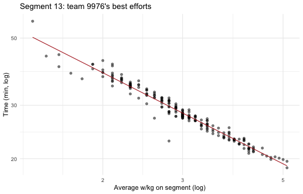
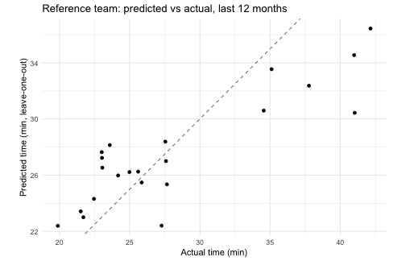
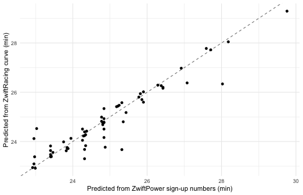
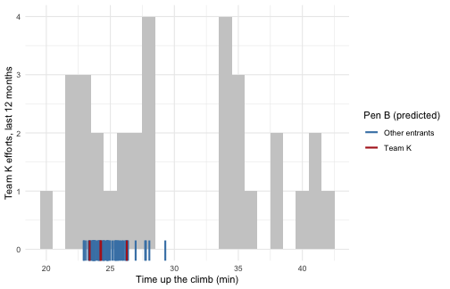

> **Note:** this page was rendered from live data. Rider names, rider ids and
> team names in the output have been replaced with pseudonyms ("Rider 12",
> "Team A", ids from 100000001 up); everything else is as the APIs returned it.

**Question:** before a race, who in my pen is likely to get up the big climb
fastest, and how long will it take them?

The recipe uses all three APIs:

1. **Zwift** — who is signed up to the pen.
2. **ZwiftPower** — a team's real efforts on the climb, to learn how
   w/kg turns into time on *this* segment; plus each entrant's sign-up power
   numbers.
3. **ZwiftRacing.app** — each entrant's recent power curve.

The worked example is Zwift Racing League event `5811034` (Muir and the
Mountain), pen B, and the climb is ZwiftPower segment `13` — the **Watopia Epic
KOM (forward)**. Change the four values below to reuse it for any race.


``` r
library(zwiftverse)
library(dplyr)
library(tidyr)
library(ggplot2)

event_id   <- 5811034   # Zwift / ZwiftPower event id
pen        <- "B"       # subgroup label
segment_id <- 13        # ZwiftPower segment id (see zp_primes()$sprint_id)
team_id    <- 9976      # ZwiftPower team whose efforts calibrate the model

za <- zwift_auth()
zp <- zp_set_cookie(zp_session(), Sys.getenv("ZP_SID"))
zr <- zr_client()
```

## 1. Who is racing in the pen

Zwift's own entrant list is the authority on who is signed up. Each subgroup
(pen) has its own id:


``` r
pens <- zwift_event_subgroups(za, event_id)
pens |> select(id, subgroupLabel, eventSubgroupStart, totalEntrantCount)
#> # A tibble: 5 x 4
#>        id subgroupLabel eventSubgroupStart           totalEntrantCount
#>     <int> <chr>         <chr>                                    <int>
#> 1 7500062 A             2026-11-24T06:01:00.000+0000                23
#> 2 7500059 B             2026-11-24T06:02:00.000+0000                62
#> 3 7500060 C             2026-11-24T06:03:00.000+0000                49
#> 4 7500061 D             2026-11-24T06:04:00.000+0000                29
#> 5 7500058 E             2026-11-24T06:00:00.000+0000                 2

pen_id <- pens$id[pens$subgroupLabel == pen]

entrants <- zwift_subgroup_entrants(za, pen_id) |>
  transmute(zwid = id, rider = paste(firstName, lastName),
            weight_kg = weight / 1000)
nrow(entrants)
#> [1] 62
```

ZwiftPower's sign-up list adds the team and ZwiftPower's own 5- and 20-minute
bests. It labels pens 1–5 rather than A–E:


``` r
zp_pen <- match(pen, LETTERS)

zp_signup <- zp_signups(zp, event_id) |>
  zp_unflag() |>
  filter(label == zp_pen) |>
  transmute(zwid = as.integer(zwid), team = trimws(tname),
            zp_wkg5 = as.numeric(cp_300_wkg), zp_wkg20 = as.numeric(cp_1200_wkg))

field <- entrants |> left_join(zp_signup, by = "zwid")
field |> count(team, sort = TRUE)
#> # A tibble: 14 x 2
#>    team         n
#>    <chr>    <int>
#>  1 "Team C"    10
#>  2 "Team A"     9
#>  3 "Team B"     9
#>  4 "Team F"     9
#>  5 "Team D"     5
#>  6 "Team G"     5
#>  7 "Team I"     4
#>  8 "Team K"     4
#>  9 "Team H"     2
#> 10 ""           1
#> 11 "Team E"     1
#> 12 "Team J"     1
#> 13 "Team L"     1
#> 14 "Team M"     1
```

## 2. How w/kg becomes time on this climb

Rather than simulating Zwift's physics (gradient profile, drafting, bike
choice), learn the relationship from real races. `zp_segment_standings()`
returns every best effort a team's riders have set on the segment: elapsed time
and average w/kg.


``` r
team_efforts <- zp_segment_standings(zp, segment_id, team_id) |>
  zp_unflag() |>
  transmute(zwid, elapsed = as.numeric(elapsed), wkg = as.numeric(wkg),
            when = as.POSIXct(date, origin = "1970-01-01")) |>
  filter(elapsed > 0, wkg > 0)

nrow(team_efforts)
#> [1] 215
summary(team_efforts$elapsed / 60)
#>    Min. 1st Qu.  Median    Mean 3rd Qu.    Max. 
#>   18.65   24.43   27.89   29.03   32.76   56.83
```

On a long climb, time falls as a power law of w/kg. A straight line on log–log
axes captures it:


``` r
climb_fit <- lm(log(elapsed) ~ log(wkg), data = team_efforts)
summary(climb_fit)$r.squared
#> [1] 0.9582186
coef(climb_fit)
#> (Intercept)    log(wkg) 
#>   8.2665703  -0.7555259

# time (s) for a given average w/kg on this segment
climb_time <- function(wkg) exp(predict(climb_fit, data.frame(wkg = wkg)))

ggplot(team_efforts, aes(wkg, elapsed / 60)) +
  geom_point(alpha = 0.5) +
  geom_function(fun = function(x) climb_time(x) / 60, colour = "firebrick") +
  scale_x_log10() + scale_y_log10() +
  labs(x = "Average w/kg on segment (log)", y = "Time (min, log)",
       title = sprintf("Segment %d: team %d's best efforts", segment_id, team_id)) +
  theme_minimal()
```



The exponent is shallower than −1: doubling w/kg doesn't halve the time,
because rolling resistance and air drag don't scale with power (and race
efforts include some drafting).

## 3. Each rider's power curve

ZwiftRacing.app's rider record carries each rider's 90-day best power at
5 s – 20 min. `zr_riders()` fetches the whole field in one batch request:


``` r
# 5- and 20-minute points (w/kg), one row per rider
zr_points <- function(ids) {
  zr_riders(zr, ids) |>
    transmute(zwid = as.integer(riderId), zr_wkg5 = power.wkg300, zr_wkg20 = power.wkg1200)
}

field <- field |> left_join(zr_points(field$zwid), by = "zwid")
sum(!is.na(field$zr_wkg20))   # entrants with a ZwiftRacing curve
#> [1] 62
```

## 4. From a power curve to a climb time

The climb takes longer than 20 minutes — beyond the longest measured duration
— so extrapolate with the two-parameter **critical power** model,
P(t) = CP + W′/t, fitted exactly through the 5- and 20-minute points:


``` r
sustainable <- function(p5, p20, t) {
  w_prime <- (p5 - p20) / (1 / 300 - 1 / 1200)   # work capacity above CP (J/kg)
  cp <- p20 - w_prime / 1200
  cp + w_prime / t
}
```

A rider's climb time is the duration *t* at which the w/kg they hold for *t*
seconds gets them up the climb in exactly *t* seconds. Riders in a race don't
climb at 100% of their curve, so scale it by a **race-day fraction** *k*
(estimated in the next section):


``` r
predict_climb <- function(p5, p20, k = 1) {
  if (anyNA(c(p5, p20)) || p5 <= p20 || p20 <= 0) return(NA_real_)
  f <- function(t) t - climb_time(k * sustainable(p5, p20, t))
  tryCatch(uniroot(f, c(300, 7200))$root, error = function(e) NA_real_)
}
```

## 5. Calibrate against the team's real efforts

For each of the reference team's riders we know both their actual time up
the climb and their current power curve. Comparing the w/kg they *actually*
held with what their curve says they *could* hold for that long gives *k*.
Only use efforts from the last year — older ones were set by a fitter (or
less fit) version of the rider than today's curve describes:


``` r
cal <- team_efforts |>
  filter(when > Sys.time() - 365 * 86400) |>
  inner_join(zr_points(team_efforts$zwid), by = "zwid") |>
  filter(zr_wkg5 > zr_wkg20) |>
  mutate(frac = wkg / sustainable(zr_wkg5, zr_wkg20, elapsed))

k <- median(cal$frac)
c(n = nrow(cal), k = round(k, 3), sd = round(sd(cal$frac), 3))
#>      n      k     sd 
#> 22.000  0.924  0.130
```

How good are the predictions? Leave each effort out, re-estimate *k* from the
rest, and predict it:


``` r
cal$loo <- vapply(seq_len(nrow(cal)), function(i)
  predict_climb(cal$zr_wkg5[i], cal$zr_wkg20[i], k = median(cal$frac[-i])), numeric(1))

cal |>
  summarise(n = n(),
            bias_s = mean(loo - elapsed),
            mae_s  = mean(abs(loo - elapsed)),
            mape   = mean(abs(loo - elapsed) / elapsed))
#> # A tibble: 1 x 4
#>       n bias_s mae_s  mape
#>   <int>  <dbl> <dbl> <dbl>
#> 1    22  -34.9  193. 0.110

ggplot(cal, aes(elapsed / 60, loo / 60)) +
  geom_abline(linetype = 2, colour = "grey50") +
  geom_point() +
  coord_equal() +
  labs(x = "Actual time (min)", y = "Predicted time (min, leave-one-out)",
       title = "Reference team: predicted vs actual, last 12 months") +
  theme_minimal()
```



Expect individual predictions to be good to roughly the MAPE above — riders
differ a lot in how hard they actually go on a race climb — but the *ordering*
of a pen is more robust than any single time.

## 6. Predict the pen

Run every entrant through both sources of power numbers, with the calibrated
*k*:


``` r
preds <- field |>
  mutate(
    zr_min   = mapply(predict_climb, zr_wkg5, zr_wkg20, k = k) / 60,
    zp_min   = mapply(predict_climb, zp_wkg5, zp_wkg20, k = k) / 60,
    best_min = coalesce(zr_min, zp_min)
  ) |>
  arrange(best_min)

preds |>
  select(rider, team, zr_wkg20, zr_min, zp_min) |>
  mutate(across(where(is.numeric), \(x) round(x, 1))) |>
  print(n = Inf)
#> # A tibble: 62 x 5
#>    rider    team     zr_wkg20 zr_min zp_min
#>    <chr>    <chr>       <dbl>  <dbl>  <dbl>
#>  1 Rider 13 "Team C"      4.3   22.9   23  
#>  2 Rider 48 "Team F"      4.3   22.9   22.9
#>  3 Rider 31 "Team B"      4.3   23.1   23  
#>  4 Rider 14 "Team A"      4.2   23.3   24.3
#>  5 Rider 33 "Team C"      4.2   23.4   23  
#>  6 Rider 39 "Team K"      4.2   23.4   23.4
#>  7 Rider 25 "Team A"      4.2   23.4   23.4
#>  8 Rider 57 "Team C"      4.2   23.5   23.4
#>  9 Rider 42 "Team F"      4.2   23.6   23.5
#> 10 Rider 28 "Team D"      4.1   23.6   23.8
#> 11 Rider 29 "Team I"      4.2   23.6   23.4
#> 12 Rider 6  "Team F"      4.1   23.7   25.3
#> 13 Rider 51 "Team F"      4.1   23.7   24.3
#> 14 Rider 21 "Team F"      4.1   23.7   23.9
#> 15 Rider 54 "Team I"      4.1   23.7   23.8
#> 16 Rider 11 "Team H"      4.1   23.8   23.8
#> 17 Rider 45 "Team A"      4.1   23.8   24.9
#> 18 Rider 10 "Team B"      4.1   23.8   23.4
#> 19 Rider 20 "Team A"      4.1   23.8   24.3
#> 20 Rider 34 "Team B"      4.1   24     23.8
#> 21 Rider 8  "Team L"      4     24     24.3
#> 22 Rider 7  "Team G"      4     24.1   23  
#> 23 Rider 49 "Team B"      4.1   24.1   24  
#> 24 Rider 44 "Team F"      4     24.2   24.8
#> 25 Rider 58 "Team K"      4     24.2   24.3
#> 26 Rider 36 "Team G"      4     24.2   24.3
#> 27 Rider 55 "Team K"      4     24.3   24.3
#> 28 Rider 38 "Team A"      4     24.4   24.3
#> 29 Rider 62 "Team M"      4     24.4   24.4
#> 30 Rider 23 "Team B"      3.9   24.5   24.8
#> 31 Rider 37 "Team B"      4     24.5   24.3
#> 32 Rider 19 "Team A"      3.9   24.5   23  
#> 33 Rider 56 "Team D"      3.9   24.7   24.8
#> 34 Rider 53 "Team F"      3.9   24.7   24.8
#> 35 Rider 41 "Team D"      3.9   24.8   24.8
#> 36 Rider 1  "Team F"      3.9   24.8   24.8
#> 37 Rider 16 "Team G"      3.9   24.8   25.4
#> 38 Rider 18 "Team B"      3.9   24.8   24.8
#> 39 Rider 12 "Team B"      3.9   24.9   24.8
#> 40 Rider 52 "Team A"      3.9   25     24.8
#> 41 Rider 26 "Team G"      3.8   25.2   25.4
#> 42 Rider 46 "Team J"      3.8   25.3   24.8
#> 43 Rider 32 "Team F"      3.8   25.4   25.2
#> 44 Rider 43 "Team D"      3.8   25.4   25.2
#> 45 Rider 9  "Team C"      3.8   25.5   25.2
#> 46 Rider 2  "Team C"      3.8   25.6   25.3
#> 47 Rider 61 "Team C"      3.8   25.6   25.9
#> 48 Rider 35 "Team B"      3.7   25.7   25.9
#> 49 Rider 60 "Team A"      3.7   25.8   25.8
#> 50 Rider 22 "Team D"      3.7   25.9   25.8
#> 51 Rider 3  ""            3.7   26     25.9
#> 52 Rider 47 "Team C"      3.6   26.2   26.4
#> 53 Rider 27 "Team G"      3.6   26.2   26.4
#> 54 Rider 50 "Team H"      3.6   26.3   26.4
#> 55 Rider 40 "Team K"      3.6   26.3   26.3
#> 56 Rider 30 "Team C"      3.6   26.3   28  
#> 57 Rider 59 "Team I"      3.6   26.4   27.1
#> 58 Rider 24 "Team A"      3.5   27     26.9
#> 59 Rider 15 "Team C"      3.4   27.7   27.7
#> 60 Rider 5  "Team E"      3.4   27.8   27.6
#> 61 Rider 17 "Team I"      3.3   28     28.2
#> 62 Rider 4  "Team C"      3.2   29.3   29.8
```

How well do the two sources agree?


``` r
with(preds, cor(zr_min, zp_min, use = "complete.obs"))
#> [1] 0.9400269

ggplot(preds, aes(zp_min, zr_min)) +
  geom_abline(linetype = 2, colour = "grey50") +
  geom_point(na.rm = TRUE) +
  labs(x = "Predicted from ZwiftPower sign-up numbers (min)",
       y = "Predicted from ZwiftRacing curve (min)") +
  theme_minimal()
```



Finally, put the pen in context: where would each entrant's predicted time
sit among the reference team's efforts on this climb over the last year?


``` r
team_name <- zp_segment_standings(zp, segment_id, team_id) |> pull(tname) |> first()

ggplot() +
  geom_histogram(aes(elapsed / 60), binwidth = 1, fill = "grey80",
                 data = filter(team_efforts, when > Sys.time() - 365 * 86400)) +
  geom_rug(aes(best_min, colour = coalesce(team == team_name, FALSE)),
           data = arrange(preds, coalesce(team == team_name, FALSE)),   # team on top
           linewidth = 1, length = unit(0.08, "npc"), na.rm = TRUE) +
  scale_colour_manual(values = c(`TRUE` = "firebrick", `FALSE` = "steelblue"),
                      labels = c(`TRUE` = team_name, `FALSE` = "Other entrants"),
                      name = sprintf("Pen %s (predicted)", pen)) +
  labs(x = "Time up the climb (min)",
       y = sprintf("%s efforts, last 12 months", team_name)) +
  theme_minimal()
```



## Caveats

- **Extrapolation.** The CP model is fitted to 5- and 20-minute points and
  asked about 20–35 minutes. It tends to be optimistic far beyond 20 minutes;
  the race-day fraction *k* absorbs some of that.
- **Race-day ≠ best.** *k* is a median: pacing, tactics, drafting and fatigue
  from the rest of the race vary a lot between riders, which is why individual
  errors are several minutes.
- **Calibration size.** *k* comes from one team's efforts in the last year
  (a couple of dozen); efforts older than that are excluded because today's
  power curve no longer describes the rider who set them.
- **One climb model.** The time–w/kg line is learned from one team's efforts
  in races (some drafted, some solo). A different team gives a slightly
  different line.
- **Coverage.** Riders without a ZwiftRacing curve fall back to ZwiftPower's
  sign-up numbers; riders with neither can't be predicted. Riders who are on
  Zwift's entrant list but haven't signed up on ZwiftPower have no team.
  GDPR opt-outs simply don't appear.
