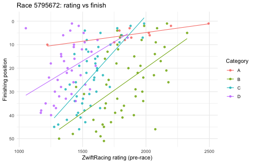

> **Note:** this page was rendered from live data. Rider names, rider ids and
> team names in the output have been replaced with pseudonyms ("Rider 12",
> "Team A", ids from 100000001 up); everything else is as the APIs returned it.

This walkthrough answers one question end to end: **for a given race, does a
rider's ZwiftRacing.app rating predict where they finished?** It touches all
three sources — finishers from ZwiftPower, ratings from ZwiftRacing.app, and a
spot-check against the Zwift game API — and leans on the cache so repeated runs
don't re-hit the servers.

## Credentials

Put these in `~/.Renviron` (never in code you commit), then restart R:


``` r
ZWIFT_USERNAME=you@example.com
ZWIFT_PASSWORD=...
ZR_AUTH=your-zwiftracing-key     # account key from zwiftracing.app Settings
ZP_SID=...                       # phpbb3_lswlk_sid cookie from zwiftpower.com
```


``` r
library(zwiftverse)
library(dplyr)
```

The field names returned by each API are not stable or documented, so the first
thing to do with any new endpoint is look at what came back:


``` r
zp  <- zp_set_cookie(zp_session(), Sys.getenv("ZP_SID"))
race_id <- 5795672L        # a completed race (ZwiftPower id = Zwift event id)

res <- zp_result(zp, race_id)
names(res)                 # confirm the id / position / category column names
#>  [1] "DT_RowId"        "ftp"             "friend"          "pt"             
#>  [5] "label"           "zid"             "pos"             "position_in_cat"
#>  [9] "name"            "cp"              "zwid"            "res_id"         
#> [13] "lag"             "uid"             "time"            "time_gun"       
#> [17] "gap"             "vtta"            "vttat"           "male"           
#> [21] "tid"             "topen"           "tname"           "tc"             
#> [25] "tbc"             "tbd"             "zeff"            "category"       
#> [29] "height"          "flag"            "avg_hr"          "max_hr"         
#> [33] "hrmax"           "hrm"             "weight"          "power_type"     
#> [37] "display_pos"     "src"             "age"             "zada"           
#> [41] "note"            "div"             "divw"            "skill"          
#> [45] "skill_b"         "skill_gain"      "np"              "hrr"            
#> [49] "hreff"           "avg_power"       "avg_wkg"         "wkg_ftp"        
#> [53] "wftp"            "wkg_guess"       "wkg1200"         "wkg300"         
#> [57] "wkg120"          "wkg60"           "wkg30"           "wkg15"          
#> [61] "wkg5"            "w1200"           "w300"            "w120"           
#> [65] "w60"             "w30"             "w15"             "w5"             
#> [69] "is_guess"        "upg"             "penalty"         "reg"            
#> [73] "fl"              "pts"             "pts_pos"         "info"           
#> [77] "info_notes"      "log"             "lead"            "sweep"          
#> [81] "actid"           "anal"            "notes"
```

The ZwiftPower columns used below (`zwid`, `name`, `position_in_cat`,
`category`, `avg_wkg`) are confirmed against live data.

## 1. Finishers from ZwiftPower

`zp_result()` returns one row per finisher. ZwiftPower ships most numbers as
`[value, flag]` pairs (they arrive as list-columns), so run `zp_unflag()`
first, then pull the rider id, finishing position and category. Column names
below were verified against live responses (2026-11).


``` r
finishers <- res |>
  zp_unflag() |>
  transmute(
    zwid     = as.integer(zwid),          # ZwiftPower rider id
    name,
    position = as.integer(position_in_cat),
    category,
    wkg_avg  = as.numeric(avg_wkg)
  ) |>
  arrange(category, position)

finishers
#> # A tibble: 147 x 5
#>         zwid name     position category wkg_avg
#>        <int> <chr>       <int> <chr>      <dbl>
#>  1 100000001 Rider 1         1 A            4.2
#>  2 100000002 Rider 2         2 A            3.9
#>  3 100000003 Rider 3         3 A            3.7
#>  4 100000004 Rider 4         4 A            3.8
#>  5 100000005 Rider 5         5 A            3.9
#>  6 100000006 Rider 6         6 A            3.6
#>  7 100000007 Rider 7         7 A            4  
#>  8 100000008 Rider 8         8 A            3.6
#>  9 100000009 Rider 9         9 A            3.5
#> 10 100000010 Rider 10       10 A            2.9
#> # i 137 more rows
```

## 2. Ratings from ZwiftRacing.app (one call)

ZwiftRacing.app can look up every finisher at once: `zr_riders()` sends one
batch request for up to 1,000 riders. With `time =` it returns each profile as
a snapshot at that moment, and the snapshot rewinds the ZwiftRacing rating
(`race.current.rating`), so asking for the race's start time gives every
finisher's rating *going into* the race. vELO is not rewound: it is always the
rider's current vELO. The start time comes from
the Zwift game API (ZwiftRacing keys riders on the Zwift id, the same number
ZwiftPower uses).


``` r
zr <- zr_client()
za <- zwift_auth()
race_start <- as.POSIXct(zwift_event(za, race_id, parse = "json")$eventStart,
                         format = "%Y-%m-%dT%H:%M:%OS", tz = "UTC")

ratings <- zr_riders(zr, finishers$zwid, time = race_start) |>
  transmute(
    zwid       = as.integer(riderId),
    zr_current = race.current.rating,   # ZwiftRacing rating at the start
    zr_velo    = velo.race              # vELO rating today (not rewound)
  )

ratings
#> # A tibble: 147 x 3
#>         zwid zr_current zr_velo
#>        <int>      <dbl>   <dbl>
#>  1 100000001      2494.    948.
#>  2 100000002      2197.    864.
#>  3 100000003      1871.    809.
#>  4 100000004      1791.    787.
#>  5 100000005      2022.    814.
#>  6 100000006      2029.    778.
#>  7 100000007      1884.    735.
#>  8 100000008      1834.    731.
#>  9 100000009      1750.    690.
#> 10 100000010      1223.    539.
#> # i 137 more rows
```

These column names were verified against the live API (2026-11). Riders who
have opted out of ZwiftRacing.app are simply missing. Without `time`,
`zr_riders()` and `zr_rider()` return the current profile.

## 3. Join and analyse


``` r
race <- finishers |>
  left_join(ratings, by = "zwid")

race |> count(is.na(zr_current))   # how many finishers had no ZR rating?
#> # A tibble: 1 x 2
#>   `is.na(zr_current)`     n
#>   <lgl>               <int>
#> 1 FALSE                 147
```

Within a category, does a higher pre-race rating go with a better finish? A rank
correlation is the honest summary here — rating and position are both ordinal
and the relationship is monotonic, not linear.


``` r
race |>
  filter(!is.na(zr_current)) |>
  group_by(category) |>
  summarise(
    n       = dplyr::n(),
    rho     = cor(zr_current, position, method = "spearman"),
    .groups = "drop"
  )
#> # A tibble: 4 x 3
#>   category     n    rho
#>   <chr>    <int>  <dbl>
#> 1 A           10 -0.758
#> 2 B           51 -0.566
#> 3 C           46 -0.665
#> 4 D           40 -0.464
```

A strong negative `rho` means the favourites (higher rating) finished nearer the
front — i.e. the result went to form.


``` r
library(ggplot2)

race |>
  filter(!is.na(zr_current)) |>
  ggplot(aes(zr_current, position, colour = category)) +
  geom_point(alpha = 0.8) +
  geom_smooth(method = "lm", se = FALSE, linewidth = 0.5) +
  scale_y_reverse() +                     # position 1 at the top
  labs(x = "ZwiftRacing rating (pre-race)", y = "Finishing position",
       colour = "Category",
       title = sprintf("Race %d: rating vs finish", race_id)) +
  theme_minimal()
#> `geom_smooth()` using formula = 'y ~ x'
```



## 4. Cross-check against the Zwift game API

ZwiftPower and ZwiftRacing.app both derive from Zwift, so the game API is the
tie-breaker when a number looks off. Here we confirm the winner's category
enforcement FTP straight from source:


``` r
za     <- zwift_auth()
winner <- race |> filter(category == "A", position == 1) |> pull(zwid)

zwift_profile(za, winner) |>
  select(any_of(c("firstName", "lastName", "ftp", "competitionMetrics")))
#> # A tibble: 1 x 4
#>   firstName lastName   ftp competitionMetrics
#>   <chr>     <chr>    <int> <list>            
#> 1 Rider     1          311 <named list [3]>
```

## Caching notes

Everything above is cached on disk, keyed on method + URL + body:


``` r
zv_cache_info()                       # what's stored, how big, how old
#> # A tibble: 438 x 3
#>    key                              bytes modified           
#>    <chr>                            <dbl> <dttm>             
#>  1 0353c1c25e47144c3511d321f62ca346  5448 2026-11-23 17:39:45
#>  2 03a66ecfaf733d74d06583da5830435b  7333 2026-11-23 17:39:55
#>  3 04da0dcf66d1340fa0e78b87f3aed7b0  9909 2026-11-26 11:20:38
#>  4 0519a0e82203fb210e92ab9d0e580699   242 2026-11-23 17:39:50
#>  5 051e3e81317f08577efea93f200f6aec   243 2026-11-23 17:39:32
#>  6 05339a4cd73e6b1046e9d595ebcb7c95  7699 2026-11-23 17:39:27
#>  7 0630ebad5f5e2fc74acc93a53e937480  1032 2026-11-26 19:05:30
#>  8 0712bed56da98c16c5c3f26d2ed06886  7506 2026-11-23 17:38:58
#>  9 07e12faf32becfc7bd8bb8cacbcb869d  4584 2026-11-23 17:39:07
#> 10 083f632a752d2f1eb3a08ef76352f5c3  8324 2026-11-23 17:39:45
#> # i 428 more rows

# Completed races never change — cache the heavy pulls permanently:
res     <- zp_result(zp, race_id, ttl = Inf)
ratings <- zr_riders(zr, finishers$zwid, time = race_start, ttl = Inf)

# Force-refresh a single call:
winner_now <- zr_rider(zr, winner, ttl = 0)

# ...or wipe everything with zv_cache_clear()
```

A rider's ZwiftRacing rating at any past moment is a snapshot away, so a rough
history is one request per date:


``` r
dates <- race_start - c(90, 60, 30, 0) * 86400
lapply(dates, function(d) zr_rider(zr, winner, time = d, parse = "json")$race$current$rating) |>
  unlist() |>
  setNames(format(dates, "%Y-%m-%d"))
#> 2026-08-20 2026-09-19 2026-10-19 2026-11-18 
#>   2325.896   2473.067   2519.877   2493.565
```

## Caveats

These are reverse-engineered APIs. Field names can shift under you, personal
data is GDPR-consent-gated (non-consenting riders simply won't appear), and the
ZwiftPower cookie login is the brittle link — if `zp_login()` fails, fall back to
`zp_set_cookie()` with a value copied from your browser.
